# Bounded Buoyancy

[](https://doi.org/10.5281/zenodo.23305636)

**Stable, accurate buoyancy for Godot 4.4+.** Light objects stop launching out of the water, floats settle after a few bobs as real ones do, rafts, crates and boats tilt and right themselves, ride the waves (their own, or those of the ocean shader you already use) and drift down rivers, balloons rise and float, wind fills sails, holed ships flood and sink, cannonballs skip across the water, things splash as they hit the water, hundreds of bodies can cross the surface at once, and it works in 2D as well as 3D.

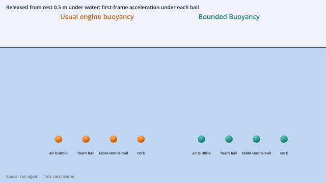

Most engines apply buoyancy as a force on the body's own mass. For anything lighter than water that has no upper limit: released under water, an air bubble accelerates at 815g in its first frame and moves 2.2 m in one 60 Hz step. Real light spheres and bubbles start at no more than about 2g, because the water around them has to be set moving too. That water is the *added mass* of classical hydrodynamics.

Bounded Buoyancy puts the added mass of the submerged part into the body's inertia every physics step:

```
M = ρ_body · V  +  C · ρ_water · V_submerged
```

Buoyancy then drives no fall faster than g and no rise faster than g/C (2g for a sphere), for every density, and the first frame after a release is the classical value. Drag and collisions act on top, as usual.

| Released from rest under water (60 Hz) | Usual engine method | Bounded Buoyancy |
| --- | ---: | ---: |
| Air bubble | 815g | 1.99g |
| Foam ball (3% of water's density) | 32.3g | 1.83g |
| Table-tennis ball | 11.4g | 1.58g |
| Cork | 3.0g | 1.00g |

The plugin reproduces these values exactly, in both of Godot's physics engines (Godot Physics and Jolt). Run `tests/run_tests.gd` to check them yourself.

**Using Unity?** A Unity version with the same physics, settings and benchmarks, for Unity 2022.3 LTS and Unity 6 in 3D and 2D, is in [`unity/`](unity/): install it from the Package Manager with the git URL `https://github.com/NPARKYN84/bounded-buoyancy.git?path=/unity/com.parkyn.bounded-buoyancy`. It floats bodies on the waves of HDRP's Water System too: HDRP draws the ocean, Bounded Buoyancy does the physics.

## Any shape, tilting and righting

Buoyancy acts at the centre of the immersed volume, worked out exactly each step by cutting the body's shape at the waterline. So bodies tip and roll the way real ones do: a raft settles flat, a tall block tips onto its side, and a boat with a low centre of mass rights itself.

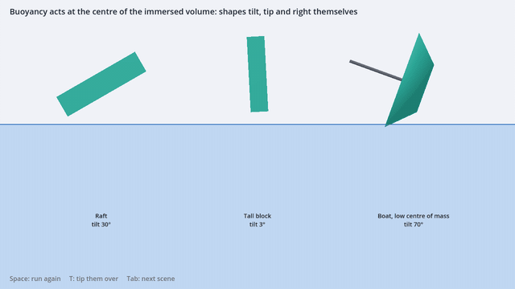

Supported shapes: sphere, box, cylinder, capsule and convex polygon (including the shapes Godot makes with *Create Convex Collision Sibling*), alone or several in one body. For anything else, such as a detailed hull, set **Buoyancy Mesh** to a closed mesh.

## Settling: the ripples a body makes

A body bobbing at the surface pushes the water out in rings, and the rings carry its energy away. That is why a real float settles after a few bobs, and why a raft settles sooner than a fishing float. Bounded Buoyancy takes that energy away too (**Wave Damping**, on by default). It acts on the body's bobbing relative to the surface under it, so a body riding waves still rises and falls with them, and a body let go from rest starts exactly as before.

How much depends on the shape, as it does in real water. A wide, shallow body makes big rings and settles in a bob or two; a deep, narrow one hardly disturbs the surface and bobs on for a long time.

| Floating body | Each bob is lower than the last by |
| --- | ---: |
| Deep post or spar buoy | 3% |
| Cube or ball floating half under | about 27% |
| Log | about 50% |
| Raft or boat | about 70% |

These amounts are not tuned by eye. They come from linear wave theory, the method engineers use for floating structures, solved exactly with the open-source solver [Capytaine](https://github.com/capytaine/capytaine) for 30 floating boxes, posts, balls and logs, from deep and narrow to wide and shallow, with one curve fitted to the results (`reference/wave_damping.py` and `reference/wave_damping.csv`). In the simulation that gives 0.8 to 1.5 times the exact damping for flat-bottomed bodies, about 0.5 to 0.7 times for balls and logs floating at least half out of the water (they come out a little bouncier than real ones), more for heavy balls floating mostly under, and within about 2% in 2D. In the checks, a wooden ball let go 3 cm below its floating height still bobs 3 mm either way after 3 s and under a fifth of a millimetre after 9 s, where without wave damping it bobs 12 mm and then 6 mm; a raft has settled within 3 s; and a raft on long waves, or carried up by rising water, keeps up with the surface as before.

Set **Wave Damping** to 0 to leave it out (the paper's benchmarks do, as they leave out air), or above 1 for more.

## Water you can place, with waves

Add a **BoundedBuoyancyWater** node where you want the surface and set its **Size**: the water fills that box below the node. Once a scene has one, bodies float only inside water nodes, so a pond, a pool and the sea can sit at different heights with different densities (1000 kg/m³ fresh, about 1025 sea). Give it a **Wave Height** and **Wave Length** and every body rides and rocks on the surface it sits on, each part of it measured against the water above that part. The water moving up and down in the waves pushes on everything in it too, so a small raft rises and falls as far as the water does (99% on waves 20 times its length, where exact wave theory gives 100%), and a ball as dense as water, drifting a metre under the surface, moves up and down with the water round it. The node draws a simple surface that moves with the waves; turn **Show Surface** off to use your own.

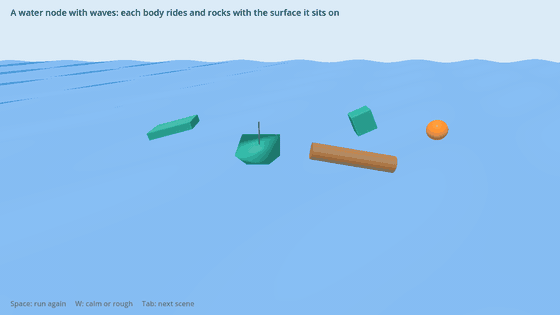

## Your own ocean, with this physics

Already have an ocean or water shader, or an ocean add-on? Keep it for the look, and let Bounded Buoyancy do the floating. Add a **BoundedBuoyancyWater** over it, set **Surface Source** to the ocean's node and **Surface Method** to the name of its function that gives the height of the surface at a world point (`func get_height(p: Vector3) -> float`, say). Bodies then ride that ocean's waves, every vertex measured against the surface above it, with the added mass, righting and drag described here. The water node still sets where bodies float (its **Size**), the water's density and any current, and it stops drawing its own surface. Set **Surface Max Wave** to the height of the ocean's highest crest above its average level; for bodies further than twice that from the surface, the ocean is asked only for the height over their centre.

From code, `height_function` takes a Callable instead: `$Water.height_function = func(p: Vector3) -> float: return ocean.wave_height_at(p)`.

For the water's own push in the waves as well, give the ocean a second function that returns the water's upward acceleration at a world point in the water (`func get_vertical_acceleration(p: Vector3) -> float`) and set **Surface Acceleration Method** to its name (or `acceleration_function` from code). For waves made of sines, each wave's part is −height × ω² × sin(phase) × e^(k z), ω the wave's frequency, k its wave number and z the point's height above the average level (no more than 0); the example ocean below has one to copy. Without it, bodies are buoyed by the ocean's surface alone, and a small raft rises and falls 5 to 15% further than the water.

Shaders run on the graphics card, where the physics cannot read them, so the ocean's script needs the same wave formula on the CPU. An ocean add-on that floats objects of its own already has such a function; for a shader of your own, copy its wave sum into GDScript. The demo's ninth scene does exactly this with an ocean drawn by its own shader (`addons/bounded_buoyancy/demo/ocean_example.gd`, a template to copy):

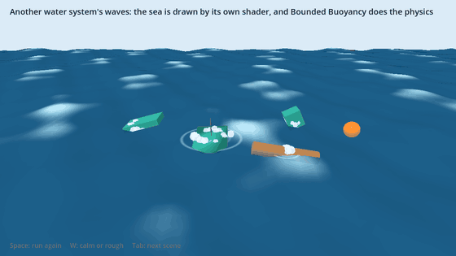

**With Ocean3D.** Tested with [Ocean3D Lite](https://store.godotengine.org/asset/ocean3d/ocean3d-lite/) 0.1.0 (free, MIT), whose `Ocean` autoload gives the height of its Gerstner sea at any point. Put a BoundedBuoyancyWater at sea level (y = 0), make its **Size** cover your sea, and in any script that runs at the start:

```gdscript
$BoundedBuoyancyWater.height_function = func(p: Vector3) -> float: return Ocean.get_height(p.x, p.z)
$BoundedBuoyancyWater.surface_max_wave = 2.0   # at least the highest crest above sea level, in metres
```

On Ocean3D's calm sea, bodies then float at the heights their densities give: over 25 s, a crate at half water's density, a raft, a log and a light ball sat on average within 2 mm of their exact floating heights above or below the surface under them.

## Rivers and currents

Give a water node a **Current** and the water flows. Drag acts on each body's speed through the water, so everything is carried along, quickly at first and then at the speed of the stream, and **Current Edge** slows the water near the banks. Turn the node to turn the river; join several to make bends. The surface shows faint streaks moving downstream.

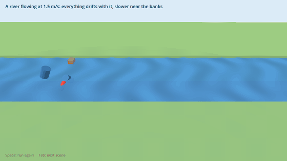

## Wind and sails

Add a **BoundedBuoyancyWind** node and the air moves, with gusts that change its strength and swing its direction, travelling downwind. The wind pushes on whatever part of a body is out of the water, so balloons drift, a crate barely moves, and a body with a **Sail Area** runs before the wind. The sail pushes at **Sail Centre**, so a boat heels, and ballast (a low centre of mass) holds it up. Limit a wind node to a box for a gap between buildings or a fan.

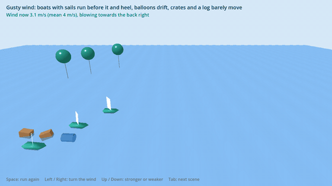

## Boats: keels, rudders, sails and propellers

Add **BoundedBuoyancyFoil** nodes under a body for its keel, centreboard, rudder, fins or sails, and a **BoundedBuoyancyThruster** for a propeller or a fan. A foil is a thin flat plate (span up its Y axis, leading edge forward along -Z); the flow past it makes a force square to its faces, lift and pressure drag together, at its own point, so a keel stops a boat sliding sideways, a rudder turns it, and a sail with a keel drives it across the wind and up into it. A thruster pushes along its -Z, less the faster it goes, so it gives a boat a top speed of its own and pushes astern when reversed.

Like the buoyancy, their forces are bounded: each step a foil's force is worked out with the flow at the end of the step, against the inertia the body has at the foil, so it can stop the flow across the foil but never throw the body back the other way. A 10 m² foil on a 1 kg body moving across it at 10 m/s, which a plain force would fling back at thousands of metres a second in one step, just stops. A propeller brings a boat up to its speed and no further.

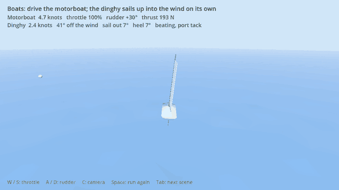

| Foil setting | Meaning | Default |
| --- | --- | --- |
| Medium | `WATER` (keel, rudder, fin: acts on its part under the water) or `AIR` (sail, wing: acts above the water, with the wind) | WATER |
| Area / Aspect Ratio | Area of one face, m², and span² / area (1 to 2 keel, 2 to 3 rudder, 3 to 5 sail) | 0.1 / 2 |
| Angle | Degrees about its span: a rudder's angle. Positive swings the trailing edge to +X, which turns a boat with the rudder at its stern to starboard | 0 |
| Effort Offset | From the node (a mast, a rudder stock) to where the force acts, along the chord, m | 0 |
| Auto Trim / Trim Angle Of Attack / Max Trim | A sail swings itself away from the wind it feels, keeping that angle to it, no further than Max Trim; running dead downwind it stays on its side until the wind is 10° round on the other (by the lee), so it does not flick across | off / 15° / 85° |

The force square to a foil's faces is ½ ρ A q² C_N(α), with C_N(α) = k sin α cos α + 1.2 sin² α, no more than 1.4 (a stalled plate). k is the lift slope of a wing of its aspect ratio (Helmbold: 2π AR / (2 + √(AR² + 4))); 1.2 is a flat plate square to the flow, the drag that Sail Area has always used. A thruster has **Max Thrust** (N), **Max Speed** (m/s, where full throttle pushes no more), **Throttle** (-1 to 1), **Diameter** and **Medium**. Each reports its `force` and `immersion`; a foil also its `angle_of_attack`. A foil remembers where it was placed (its angle 0); if you turn its node by script while the game runs, call `replace()`.

For hulls: a streamlined hull has much less drag than the default Drag Coefficient (a sphere's 0.47); 0.1 to 0.2 suits a boat. And turn **Keep Momentum On Entry** off for boats on waves: it is meant for bodies plunging into the water, and a hull dipping into each wave would otherwise lose speed every time. In the checks, a keeled motorboat slipping sideways at 0.5 m/s keeps 0.05 m/s of the slip after a second, against 0.35 m/s without a keel; with its rudder hard over it turns in a steady circle about three boat lengths across, the same either way; and a dinghy steered 45° off a 6 m/s wind gains 0.7 m/s towards it while heeling less than 8°. The demo's BOATS scene has a motorboat to drive and a dinghy that beats up into the wind in tacks on its own.

## Flooding and sinking

Add **BoundedBuoyancyCompartment** nodes under a body for the spaces inside it that can flood: a ship's holds, bow and stern sections, tanks. Each is a box (**Size**) with **Holes**, set in the inspector or made from code where something hits it: `compartment.add_hole(world_point, area)`. Water pours in through holes below the waterline by the orifice law, Q = C A √(2 g Δh), faster the deeper the hole, and drains out through holes above it. Inside, it stays level whichever way the ship leans, and its weight acts at its own centre. So a holed ship settles lower, lists toward its flooded side, and sinks or capsizes once it has taken in more water than its reserve of buoyancy will carry. **Pump Rate** takes water out again, and `patch_holes()` closes them.

The physics is the naval architect's: the hull keeps its buoyancy and the flood water is weight it carries (the added-weight method), and the loose water's surface costs the ship stability (the free-surface effect). Bulkheads matter as they do in real ships. A ship divided into compartments floods only the holed one and stays afloat, where the same ship with one big hold floods right across and goes down:

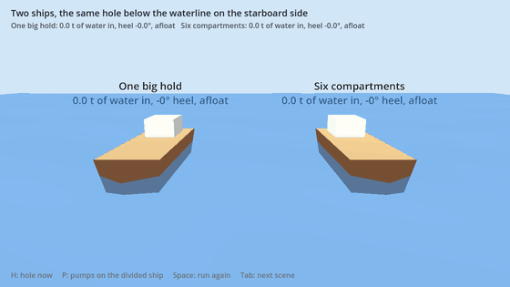

| Compartment setting | Meaning | Default |
| --- | --- | --- |
| Size | Width, height and length of the space, m, centred on the node; keep it inside the body's shape | 1 × 1 × 1 |
| Holes | Each (x, y, z, area): position in the compartment's own coordinates and area in m² (a 15 cm cannonball makes about 0.018 m²) | none |
| Discharge Coefficient | 0.6 for a sharp-edged hole, up to about 0.95 for a smooth one | 0.6 |
| Pump Rate | Water the pumps take out, m³/s | 0 |
| Flood Volume | Water inside now, m³; set it to start part full | 0 |

Each compartment reports `fill_fraction`, `inflow` (m³/s), `water_level` and `water_centre`, and the body its `flood_mass`. In the checks, a box with a hole in its floor sinks at the steady rate of the ancient sinking-bowl water clock and goes under at the time it gives (68.07 s against 68.02 s); a barge with its middle third open to the sea settles at the draft the lost-buoyancy method gives (60.0 cm); loose water moves across a leaning tank by exactly the textbook's i tan θ / V; a barge with a slack tank across its whole floor lolls over, while the same water behind bulkheads down the middle and across leaves it upright; and a ship holed on one side lists to that side, then comes upright again when the hole is patched and pumped dry.

## Cannons and round shot

Add a **BoundedBuoyancyCannon** node at a gun's muzzle, pointing the way it fires (its −Z, the way Godot nodes face), and call `fire()`. Choose the **Gun**, a 6- to 32-pounder, and the shot's size and weight are set from the British round shot of Muller's *Treatise of Artillery* (1768); the muzzle speed is a long gun's with its full charge, 488 m/s (1600 ft/s). On a ship (any RigidBody3D above the gun), the shot leaves with the ship's own velocity at the muzzle added, and the ship takes the recoil there: the shot's momentum and the powder gas's. So a broadside heels the ship as well as pushing it back.

The shot is a **BoundedBuoyancyCannonball**, a body of its own, and it carries the physics of fast round shot:

- **Drag that changes with speed.** A ball as big as a cannonball has a drag coefficient of about 0.2 below two thirds of the speed of sound, as the air round it turns turbulent (the drag crisis), rising through the sound barrier to about 1. These are the values Miller and Bailey (1979) worked out from 18th- and 19th-century cannon firings. A 24-pounder fired at 5° first grazes the water 1.72 km off, close to the mile the old range tables give; with the drag of a slow ball it would carry a quarter further.
- **Skipping off the water.** Meeting the water at a shallow angle, round shot skips, as gunners' ricochet fire did. The water pushes on the part of the ball under its surface, and the push lifts it out again if it came down at less than about 18° / √σ, σ its density over the water's (Birkhoff and others, 1944): 6.5° for iron, 11° for aluminium. The contact lasts a fraction of a physics step, so the plugin works through that step in short steps. Waves tilt the surface, so a ball that meets the face of a wave plunges in sooner.
- **Striking what it hits.** It flies 8 m in a step, so continuous collision detection is on: it strikes a hull instead of passing through it, and emits `hit(body, at, velocity)`.

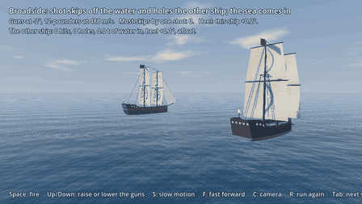

| Cannon setting | Meaning | Default |
| --- | --- | --- |
| Gun | 6-, 9-, 12-, 18-, 24- or 32-pounder (sets the shot and a full charge), or Custom | 24-pounder |
| Shot Diameter / Shot Mass | Of the round shot, m and kg | 0.141 / 10.9 |
| Muzzle Speed | m/s | 488 |
| Charge Mass | The powder, kg; its gas, leaving at half the shot's speed on average, adds to the recoil | a third of the shot's |
| Reload Time | Seconds between shots | 3 |
| Spread | Shots leave up to this many degrees off the line | 0.3 |
| Recoil | Push the ship back as the gun fires | on |
| Shot Lifetime | Seconds before a shot removes itself; 0 keeps it | 30 |
| Shot Parent | Where shots go in the scene | beside the ship |

A cannonball has **Ricochet** (on), **Speed Of Sound** (343 m/s) and **Lifetime**, and reports `skips`, `exit_velocity` and `mach`. Any fast ball can be one, a musket ball or a thrown stone ball: give it one SphereShape3D. Under the water, and once slow, it is an ordinary BoundedBuoyancyBody, so an iron ball sinks.

In the checks, the 24-pounder's first graze agrees with the same drag law worked through in steps of 0.1 ms to 0.4%; the recoil gives the ship exactly the shot's and the gas's momentum; a shot at 488 m/s stops at a 10 cm plank 30 m off; balls of relative density 7.42, 2.7 and 1.2 skip below 6.66°, 10.90° and 15.85°, against Birkhoff's 6.65°, 11.03° and 16.54°, and the angle is the same at 200 and 400 m/s; and a steel ball 7 mm across, meeting the water at 57 m/s and 1.04° to 4.53°, leaves it at the speed and angle Lyu, Yun and Wei (2021) measured:

| In at | Speed out / in, here | Measured | Angle out, here | Measured |
| ---: | ---: | ---: | ---: | ---: |
| 1.04° | 0.98 | 0.97 | 1.03° | 0.94° |
| 2.60° | 0.92 | 0.87 | 2.43° | 2.68° |
| 3.69° | 0.85 | 0.81 | 3.39° | 3.26° |
| 4.53° | 0.79 | 0.68 | 4.09° | 4.32° |

## Splashes

When a body hits a water node fast enough, the node throws up a splash of droplets, and every entry leaves rings spreading out over the surface, riding the waves. Bodies emit **water_entered** and **water_exited** with the speed and the point on the surface, for sounds. The effects are for show and do not move anything; turn them off on the water node, or call `splash()` yourself.

## Air: balloons and hot-air balloons

The same law covers air, with air's density (1.2 kg/m³) in place of water's. Whatever part of a body is out of the water is in air, so a helium balloon rises while a crate barely notices. Released from rest, a helium party balloon (0.45 kg/m³ with its skin) starts at 0.71g, not the 1.67g of the usual method, because it has to set the air around it moving. For the same reason a push moves it off as sluggishly as a real one. It then rises at about 2 m/s, held back by drag in the air.

**Density** can be changed while the game runs: heat a hot-air balloon and it lifts off, let it cool and it comes down, or fill and empty a submarine's ballast tanks. Set **Air Half Height** and the air thins with height, so a balloon that keeps its volume (a foil balloon, a hot-air balloon, an airship) rises until the air around it is as light as it is, and floats there. Real air halves about every 6 km; a game can use far less.

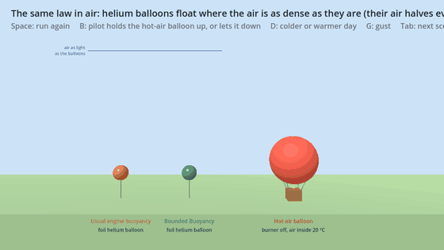

| Released from rest in air (60 Hz) | Usual engine method | Bounded Buoyancy |
| --- | ---: | ---: |
| Helium party balloon (0.45 kg/m³) | 1.67g up | 0.71g up |
| Stone (2,700 kg/m³) | 1.00g down | 1.00g down |

## 2D

`BoundedBuoyancyBody2D`, `BoundedBuoyancyWater2D` and `BoundedBuoyancyWind2D` do the same in a side view, for `RigidBody2D`: circles, rectangles, capsules, convex polygons and collision polygons; tipping and righting; waves, currents, air, wind, sails and splashes. Lengths and speeds are in pixels, as everywhere in Godot 2D, and densities in kg/m³. A circle's added-mass coefficient in 2D is 1, so a light ball rises no faster than g.

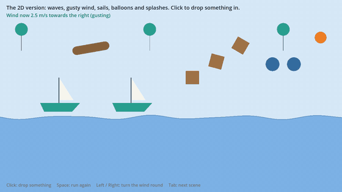

## Hundreds of bodies, and fast ones

The waterline cut runs in compiled code when the optional native kernel is installed (`addons/bounded_buoyancy_native`, included for Windows and Linux), and in GDScript otherwise. The results are the same either way. With the kernel, 300 bodies riding waves at once take 3.5 to 6 ms per frame, of the 16.7 ms a 60 fps frame allows:

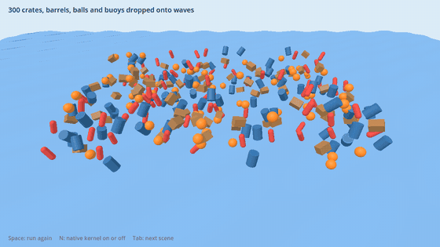

| 300 bodies on waves, ms per frame | Native kernel | GDScript only |
| --- | ---: | ---: |
| Spheres | 3.6 | 3.7 |
| Boxes | 4.0 | 10.0 |
| Convex hulls (boats) | 5.0 | 11.0 |
| Cylinders | 5.7 | 23.9 |
| Capsules | 4.8 | 54.7 |

Measured with `tests/bench_scale.gd` on a 2.1 GHz server processor, including Godot's own physics step for the bodies; faster desktop processors take less. In calm water the GDScript times are about a third lower. The plugin's own share per body is about 10 µs plus the waterline cut, 4 to 5 µs of it the settling and the water's push in waves added in version 2.3 (Wave Damping 0 skips the settling), and the added mass itself costs about 9 ns (`reference/cost_bench.c`).

Fast bodies stay stable. A stone dropped 50 m hits the water at 31 m/s and slows straight to its sinking speed of 3.1 m/s; a light ball fired into the water at 30 m/s comes back up and floats; a box skimming the surface at 25 m/s slows without tipping. The tests check all three.

## How it compares

`unity/checks/Compare` puts four ways of floating things through the same tests, on the same fixed-step integrator at 60 Hz, in the same water, with the same drag: the usual method (buoyancy as a force on the body's own mass, as most engine scripts and tutorials do), the usual method with damping in the water (the usual cure for its bouncing), pontoons with damping (spheres standing in for the shape, the method of Unreal's Water plugin and many assets), and Bounded Buoyancy. The other methods are written from their published descriptions; their damping is tuned once, to settle a wooden ball as fast as it can, and used for everything.

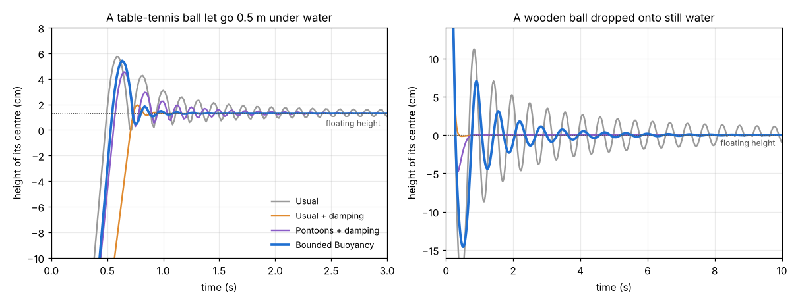

| | Usual | Usual + damping | Pontoons + damping | Bounded Buoyancy | Physics |
| --- | ---: | ---: | ---: | ---: | --- |
| Table-tennis ball let go under water: first-frame acceleration | 11g | 7.0g | 11g | 1.58g | 1.58g (added mass) |
| Wooden ball dropped onto still water: bobbing more than 1 mm until | over 20 s | 0.6 s | 0.7 s | 7.0 s | about 5 s (linear wave theory) |
| Raft on waves 20 times its length: rises and falls, of the surface | 102% | 90% | 101% | 99% | 100% (linear wave theory, `reference/wave_damping.py --raft`) |
| Raft on waves 5 times its length: rises and falls, of the surface | 106% | 61% | 92% | 93% | 98 to 100% (linear wave theory) |
| Raft on those waves: lags the surface by | 0 s | 0.18 s | 0.08 s | 0 s | close to 0 |

Damping strong enough to stop the bouncing also stops a body following the waves: on the shorter waves the damped raft rises and falls only 61% as far as the water, a beat late, and the damped ball dropped from 30 cm barely dips below its floating height. Bounded Buoyancy keeps the first frame right without any damping, takes away only the energy the ripples carry, and keeps up with the waves, though on waves only five times its length its raft rises and falls a little less than exact theory gives. The rest is in the tool's output: floating heights, a raft righting itself, the same test at 30, 60 and 120 steps a second, and the cost. `python3 chart.py` there redraws the chart.

## Install

- **From the Godot Asset Store:** [Bounded Buoyancy on the Asset Store](https://store.godotengine.org/asset/valeriex/bounded-buoyancy/), or search for *Bounded Buoyancy* in the editor's Asset Store tab (Godot 4.7 and later); install it, then enable it under Project Settings → Plugins. The download includes the demo scenes in `addons/bounded_buoyancy/demo`.
- **By hand:** copy the `addons/bounded_buoyancy` folder into your project's `addons/` folder and enable the plugin. Copy `addons/bounded_buoyancy_native` as well for the speed-up on Windows and Linux; on other platforms leave it out, or build it from the `native/` folder (its README says how, and the repository's GitHub workflow builds Windows, Linux and macOS automatically).

## Use

1. Add a `BoundedBuoyancyBody` node (it is a `RigidBody3D`), or attach `bounded_buoyancy_body.gd` to an existing one.
2. Give it one or more `CollisionShape3D` children: sphere, box, cylinder, capsule or convex polygon.
3. Set **Density** (kg/m³). Then either add a **BoundedBuoyancyWater** node for the water, or set **Water Level** (the height of a flat surface), or point **Water Surface** at a node whose height is the surface. Out of the water the body is in air (**Air Density**, 1.2 kg/m³); set that to 0 to leave air out.

The script sets the body's mass, turns off its built-in gravity and damping, and applies weight, buoyancy, drag and the righting moment itself. Collisions, pushes and other forces act as usual and are resisted by the full inertia, water included. If you add or change a body's shapes while the game runs, call `rebuild_shape()`; shapes added just after the body joins the scene are picked up by themselves.

Once a world has a water node, bodies float only inside water nodes; if the last one is removed, bodies go back to Water Level. Size water nodes with **Size** rather than by scaling them.

To give a boat ballast, set the body's **Center of Mass** to Custom and move it down; the lower it is, the harder the boat rights itself. Left on Auto, the centre of mass is put at the centre of the shape's volume.

| Setting | Meaning | Default |
| --- | --- | --- |
| Model | `BOUNDED`, or `USUAL` for side-by-side comparisons | BOUNDED |
| Density | Density of the body, kg/m³ (water is 1000); can be changed while running | 500 (wood) |
| Added Mass Coefficient | C for the shape: 0.5 sphere, about 1 long cylinder side-on | 0.5 |
| Water Level / Water Surface | Water Level is the height of a flat surface, used when the body's world has no BoundedBuoyancyWater; Water Surface, if set, takes priority over both | 0 / none |
| Water Density | kg/m³ (a BoundedBuoyancyWater uses its own) | 1000 |
| Drag Coefficient | Quadratic drag, in the water and in the air | 0.47 |
| Angular Drag | Damping of rolling and pitching in the water, per second when fully submerged; in air, in proportion to how light the body is against the air | 3.0 |
| Keep Momentum On Entry | Water set moving takes its share of momentum as the body enters | on |
| Wave Damping | The energy bobbing sends out as ripples, from linear wave theory: 1 is the physics, 0 leaves it out | 1 |
| Air Density | Density of the air at height 0, kg/m³; 0 leaves air out | 1.2 |
| Air Half Height | Height over which the air's density halves; 0 keeps it the same at every height | 0 |
| Sail Area / Sail Centre | Area of a sail for the wind to push on, m², and where it pushes, in the body's coordinates | 0 / (0, 0.5, 0) |
| Buoyancy Mesh | Optional closed mesh used instead of the collision shapes | none |
| Curve Segments | Facets around cylinders and capsules (the volume is corrected to the exact value) | 16 |

The water node has **Size**, **Density**, **Wave Height**, **Wave Length** and **Wave Direction**, **Current** and **Current Edge**, **Splashes**, **Ripples** and **Splash Min Speed**, and, to use another water system's surface, **Surface Source**, **Surface Method**, **Surface Max Wave** and **Surface Acceleration Method** (or `height_function` and `acceleration_function` from code). From code, `height_at(p)` and `vertical_acceleration_at(p)` give the surface's height and the water's upward acceleration at a world point. The wind node has **Velocity**, **Gust Strength**, **Gust Period**, **Direction Swing**, and **Everywhere** or a **Size** to fill.

## Demo

Open the project folder in Godot 4.4 or later and press Play. The first scene releases four light balls under water, usual method on the left and Bounded Buoyancy on the right, and shows each ball's first-frame acceleration. Press **Tab** for the second scene, a light float dropped onto the water; again for the third, a raft, a tall block and a boat finding their floating positions (**T** tips them over); again for the fourth, five bodies on waves (**W** switches between calm and rough); again for the fifth, two foil helium balloons and a hot-air balloon in air that thins with height (**B** turns the burner on and off, **G** gives both balloons the same push); again for the sixth, 300 bodies dropped onto waves with the time the buoyancy takes each frame (**N** switches the native kernel on and off); again for the seventh, a river carrying everything dropped into it; again for the eighth, a gusty wind over a lake (the arrow keys turn it and make it stronger or weaker); again for the ninth, the same five bodies on an ocean drawn by its own shader (**W** again); again for the tenth, boats: drive the motorboat with **W**/**S** (throttle) and **A**/**D** (rudder) while the dinghy sails up into the wind on its own (**C** changes the camera); again for the eleventh, two ships holed alike, one with a single hold that sinks and one divided into compartments that stays afloat (**H** holes them at once, **P** pumps the divided one dry); again for the twelfth, a ship firing broadsides at another, its shot skipping across the water (**Space** fires, the arrow keys raise and lower the guns, **S** slows it down, **R** runs it again); and again for the thirteenth, the 2D version (click to drop things in). **Space** runs any other scene again. In your own project, open `addons/bounded_buoyancy/demo/demo.tscn` and press F6 to run it.

## Check the numbers

```
godot --headless --fixed-fps 60 --script res://tests/run_tests.gd
```

prints the first-frame accelerations and the release-and-surfacing results from the paper, then checks volumes, centres of buoyancy and righting for each shape, water nodes and waves, balloons in air, fast bodies, rivers, wind and sails, splashes, the 2D version, another water system's surface (bodies on a copy of a water node's waves must move exactly as on the waves themselves), foils and propellers (lift at known angles, the bounded force, a keel against leeway, a fin behind or ahead of the centre of mass, a propeller's top speed, turning circles both ways, a boat at anchor swinging bow upstream, and a dinghy sailing upwind), wave-making damping (the damping against the exact values, bobs dying away at the rate it gives, floats settling, a raft still riding waves and rising water, no kick from a teleport, a step into other water or water lifted at once), and the water's push in waves (its acceleration against the surface's own, for the water node, the 2D water and the example ocean; a ball as dense as water moving with the water under the waves; steep waves held to half of g), flooding (the sinking-bowl water clock, lost buoyancy, the free-surface effect and bulkheads, a list toward the damaged side, pumping dry), and cannons (range in a vacuum and through the air, recoil, striking a plank at 488 m/s, the critical angle for skipping, and a steel ball's skip against measurements), and ends with PASS. The paper's benchmarks leave out air and wave-making damping, so those checks set Air Density and Wave Damping to 0. Add `-- --gdscript` to run everything without the native kernel; the results agree. The `reference/` folder has the paper's Python reference implementation (`bounded_buoyancy.py`), the cost benchmark (`cost_bench.c`), and the exact wave-making damping results and their fit (`wave_damping.py`, `wave_damping.csv`).

Without the native kernel, lower **Curve Segments** to make cylinders and capsules cheaper (`tests/bench_immerse.gd` times each shape).

## Limits

- Submerged volumes are exact for every shape (cylinders, capsules and spheres in compound bodies to within the facets, corrected to the exact total). Overlapping shapes in one body are counted twice, and a buoyancy mesh must be closed.
- One added-mass value per body, which is exact for spheres and for the vertical motion of other shapes. Direction-dependent added mass needs an engine that accepts a mass matrix.
- Rotation uses the body's own inertia; the water's share in rolling and pitching is stood in for by Angular Drag.
- Waves move the surface only. The energy a body's bobbing sends out as ripples is taken away (Wave Damping), but the ripples themselves do not move other bodies, a moving boat makes no wake to slow it, and splashes are drawn, not simulated. Wave damping acts on bobbing up and down; rolling and pitching are slowed by Angular Drag. It is worked out for deep water, from the volume under water and the depth of its centre, so two shapes that share those settle alike. The volume under a wave is accurate while the waves are long compared with the body.
- Only the water's up-and-down motion in waves pushes bodies; its to-and-fro motion does not, so things floating in waves do not sway back and forth with them, or drift slowly the way the waves run. A body that is a good part of a wavelength long rises and falls a little less than linear wave theory gives (a raft on waves five times its length, 93% against 98%). On another water system's surface the push needs the water's acceleration (**Surface Acceleration Method**); without it, bodies are buoyed by the surface alone and a small raft rises and falls 5 to 15% further than the water.
- Wave damping acts in the steps that find a body partly under water. A light ball shooting out of the water crosses the surface in a step or two, so how high it pops up depends a little on the time step (4.7, 4.1 and 3.9 cm above its floating height at 30, 60 and 120 steps a second, against 4.4 cm at each without wave damping).
- Compartments are boxes, taken to be vented (air gets out as water comes in), and their water moves at once to lie level: it does not slosh. They should lie inside the body's shape: the hull's buoyancy is worked out from its shape whatever is inside it. The 2D bodies have no compartments yet.
- Round shot is a sphere, so the water's push on it needs no turning: shapes other than a lone sphere do not skip (a flat stone sinks). The push is Birkhoff's: pressure ½ ρ u² on the part under the surface facing the ball's path, as the surface stood before the ball met it; the splash and the hollow it opens are drawn, not simulated. On calm water a ball fired low skips on, hop after hop, for kilometres; on waves it plunges after a few. Shot does not yet break through hulls or hole them; it strikes and bounces off. The 2D bodies have no cannons yet.
- From another water system only the height of the surface is taken: near the surface, one request per vertex of the body's shape each step, plus one at its centre (just one for a lone sphere), so for big fleets on an expensive ocean use simple shapes or a low-poly Buoyancy Mesh. Its currents are not read; set **Current** on the water node. The 2D water has no other-system link yet.
- A current is the same everywhere in its water node (apart from the banks), and so is the wind in its node (apart from gusts). A body's own drag acts at its centre, so a current or wind turns it only through its foils (a keel aft of the centre of mass weathervanes a boat at anchor; a boat already drifting with the water has nothing flowing past it and does not turn). Sail Area always faces the wind it feels; for sailing across or into the wind, use a sail foil and a keel.
- Foils are flat plates: no camber, and no lift from the hull itself (a hull with no keel slides sideways freely). The lift slope allows for the foil's aspect ratio, but not for one foil's wake meeting another (a rudder behind a keel works in clean water here). Propellers do not turn the boat by their torque.
- A latex balloon stretches as it rises and keeps going until it bursts; that is not modelled. Balloons that keep their volume (foil balloons, hot-air balloons, airships) are.
- For very shallow floats (drafts of a few millimetres on a large ball) the submerged-volume added mass is several times too small, so their bobbing is faster than real. Any added-mass value can be set instead.
- Floats with drafts below about a millimetre need sub-steps at 60 Hz, as in any explicit buoyancy scheme.
- Gravity is read from the project settings each frame (straight down); Area3D gravity zones and other gravity directions are not used for buoyant bodies.
- The native kernel is included for Windows and Linux (64-bit; Linux needs a system from about 2021 on, such as Ubuntu 22.04). On other platforms Godot reports at start-up that it has no library for the kernel, and the plugin runs in GDScript; delete `addons/bounded_buoyancy_native` there, or build it from `native/`.

## Prior work

Added mass is classical (Lamb, 1932; Brennen, 1982). Engineering simulators such as Vortex Studio and Gazebo already put it in the inertia, and in graphics Weißmann and Pinkall (2012) gave fully submerged rigid bodies the Kirchhoff added-mass tensor. Cutting a body's triangles at the waterline to find the immersed part is a standard game technique (Kerner, 2015). What this adds is a form a game engine can use as it stands: for bodies crossing the water surface, at the engine's own frame rate and integrator, with two stated ceilings and benchmarks.

## Cite

Parkyn, N. (2026). *Bounded Buoyancy: Added Mass and Two Ceilings for Stable, Accurate Buoyancy in Game and Simulation Engines*, v1.1. Companion paper to *ValerieX (VXXX): The Density-State Drive*, v2.2. Zenodo. https://doi.org/10.5281/zenodo.23304509

To cite the plugin itself: Parkyn, N. (2026). *Bounded Buoyancy: stable, accurate buoyancy for Godot and Unity* [Software]. Zenodo. https://doi.org/10.5281/zenodo.23305636 (this DOI always leads to the latest version).

The physics behind it, the density-state drive and its geometry family, is set out in the ValerieX (VXXX) paper.

## Licence

MIT. Free for any use, including commercial, as long as the licence notice stays with the code.
