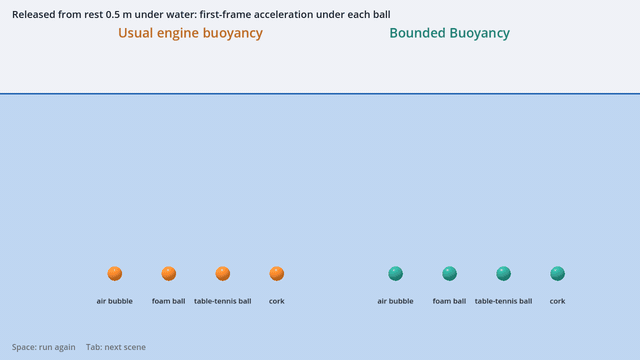
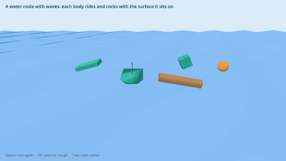
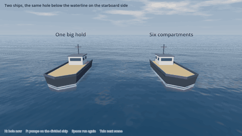

# Bounded Buoyancy

[](https://doi.org/10.5281/zenodo.23305636)

**Floating done properly, in one node.** Put a BoundedBuoyancyBody on your RigidBody3D and give it a density. It floats at the right depth, tilts and rights itself, rides the waves and never shoots out of the water. That is the whole setup.

**Thirty seconds:** enable the plugin · add the node to a RigidBody3D that has a collision shape · set **Density**. Water is at height 0 until you place a BoundedBuoyancyWater node where you want it.

**"Isn't an upward force in an Area3D enough?"** For a box sitting still, yes. The moment anything lighter than water goes under (a ball thrown in, a crate off a jetty) a plain upward force on its own mass launches it out at tens of g. This node puts the water the body has to shove aside into its inertia, so it comes up as real things do. Same effort, right answer, and it stays right when you add waves, boats, wind, flooding and the rest below.

**When you want more** (each a node or a setting, none of it required): floats settle after a few bobs as real ones do; rafts, crates and boats tilt and right themselves, ride the waves (their own, or those of the ocean shader you already use) and drift down rivers; balloons rise and float; wind fills sails; holed ships flood and sink; cannonballs skip across the water; floats dip as fish bite and hooked fish fight the line; things splash as they hit the water; hundreds of bodies can cross the surface at once; and it works in 2D as well as 3D. Godot 4.4+, Godot Physics or Jolt.



Most engines apply buoyancy as a force on the body's own mass. For anything lighter than water that has no upper limit: released under water, an air bubble accelerates at 815g in its first frame and moves 2.2 m in one 60 Hz step. Real light spheres and bubbles start at no more than about 2g, because the water around them has to be set moving too. That water is the *added mass* of classical hydrodynamics.

Bounded Buoyancy puts the added mass of the submerged part into the body's inertia every physics step:

```
M = ρ_body · V  +  C · ρ_water · V_submerged
```

Buoyancy then drives no fall faster than g and no rise faster than g/C (2g for a sphere), for every density, and the first frame after a release is the classical value. Drag and collisions act on top, as usual.

| Released from rest under water (60 Hz) | Usual engine method | Bounded Buoyancy |
| --- | ---: | ---: |
| Air bubble | 815g | 1.99g |
| Foam ball (3% of water's density) | 32.3g | 1.83g |
| Table-tennis ball | 11.4g | 1.58g |
| Cork | 3.0g | 1.00g |

The plugin reproduces these values exactly, in both of Godot's physics engines (Godot Physics and Jolt). Run `tests/run_tests.gd` to check them yourself.

**Using Unity?** A Unity version with the same physics, settings and benchmarks, for Unity 2022.3 LTS and Unity 6 in 3D and 2D, is in [`unity/`](unity/): install it from the Package Manager with the git URL `https://github.com/NPARKYN84/bounded-buoyancy.git?path=/unity/com.parkyn.bounded-buoyancy`. It floats bodies on the waves of HDRP's Water System too: HDRP draws the ocean, Bounded Buoyancy does the physics.

## What's in the box

Each of these is a node or a setting, and the [guide](docs/GUIDE.md) has the details and the settings for every one.

| | |
| --- | --- |
| **Any shape, tilting and righting** — sphere, box, cylinder, capsule, convex, several in one body, or any mesh (open ones are closed for you); buoyancy acts at the centre of the immersed part, so things tip and right themselves | [guide](docs/GUIDE.md#any-shape-tilting-and-righting) |
| **Settling** — a bobbing body sends out ripples and comes to rest in a few bobs, as real ones do, with no added damping | [guide](docs/GUIDE.md#settling-the-ripples-a-body-makes) |
| **Water you can place, with waves** — BoundedBuoyancyWater nodes anywhere, each with its own level, density and waves | [guide](docs/GUIDE.md#water-you-can-place-with-waves) |
| **Real water** — density from temperature, salt and depth (UNESCO), a thermocline, and oil, brine or mud layers | [guide](docs/GUIDE.md#real-water-temperature-salt-depth-and-layers) |
| **Your own ocean** — the ocean shader you already use draws the water; this does the physics on its surface | [guide](docs/GUIDE.md#your-own-ocean-with-this-physics) |
| **Rivers and currents** — water that flows and carries things, slower by the banks | [guide](docs/GUIDE.md#rivers-and-currents) |
| **Wind and sails** — gusty wind that pushes what stands out of the water; sails that heel a boat | [guide](docs/GUIDE.md#wind-and-sails) |
| **Boats** — keels, rudders, sails that trim themselves and propellers, as foils and thrusters | [guide](docs/GUIDE.md#boats-keels-rudders-sails-and-propellers) |
| **Flooding and sinking** — compartments that fill through holes by the orifice law, so ships list, settle and go down | [guide](docs/GUIDE.md#flooding-and-sinking) |
| **Cannons, round shot and damage** — shot that flies with a cannonball's drag, skips off the water and holes planking by Poncelet's law | [guide](docs/GUIDE.md#cannons-and-round-shot) |
| **Fishing** — lines that pull and never push, floats, and fish that bite, run and tire | [guide](docs/GUIDE.md#fishing-lines-floats-and-fish) |
| **Splashes, air and balloons, 2D** — splashes and rings; the same law in air for balloons and hot-air balloons in the standard atmosphere; all of it for RigidBody2D too | [guide](docs/GUIDE.md#splashes) |
| **Hundreds of bodies** — an optional native kernel (Windows and Linux; a Mac can build its own from `native/`) for crowds of floating things | [guide](docs/GUIDE.md#hundreds-of-bodies-and-fast-ones) |
| **How it compares** — against the usual method and the other ways of floating things, on the same tests | [guide](docs/GUIDE.md#how-it-compares) |




## Install

- **From the Godot Asset Store:** [Bounded Buoyancy on the Asset Store](https://store.godotengine.org/asset/valeriex/bounded-buoyancy/), or search for *Bounded Buoyancy* in the editor's Asset Store tab (Godot 4.7 and later); install it, then enable it under Project Settings → Plugins. The download includes the demo scenes in `addons/bounded_buoyancy/demo`.
- **By hand:** copy the `addons/bounded_buoyancy` folder into your project's `addons/` folder and enable the plugin. Copy `addons/bounded_buoyancy_native` as well for the speed-up on Windows and Linux; on other platforms leave it out, or build it from the `native/` folder (its README says how, and the repository's GitHub workflow builds Windows, Linux and macOS automatically).

## Use

1. Add a `BoundedBuoyancyBody` node (it is a `RigidBody3D`), or attach `bounded_buoyancy_body.gd` to an existing one.
2. Give it one or more `CollisionShape3D` children: sphere, box, cylinder, capsule or convex polygon.
3. Set **Density** (kg/m³). Then either add a **BoundedBuoyancyWater** node for the water, or set **Water Level** (the height of a flat surface), or point **Water Surface** at a node whose height is the surface. Out of the water the body is in air (**Air Density**, 1.2 kg/m³); set that to 0 to leave air out.

The script sets the body's mass, turns off its built-in gravity and damping, and applies weight, buoyancy, drag and the righting moment itself. Collisions, pushes and other forces act as usual and are resisted by the full inertia, water included. If you add or change a body's shapes while the game runs, call `rebuild_shape()`; shapes added just after the body joins the scene are picked up by themselves.

Once a world has a water node, bodies float only inside water nodes; if the last one is removed, bodies go back to Water Level. Size water nodes with **Size** rather than by scaling them.

To give a boat ballast, set the body's **Center of Mass** to Custom and move it down; the lower it is, the harder the boat rights itself. Left on Auto, the centre of mass is put at the centre of the shape's volume.

All the settings of the body, the water, the wind and the rest are listed in the [guide](docs/GUIDE.md#settings).

## Demo

Open the project folder in Godot 4.4 or later and press Play. The first scene releases four light balls under water, usual method on the left and Bounded Buoyancy on the right, and shows each ball's first-frame acceleration. Press **Tab** for the second scene, a light float dropped onto the water; again for the third, a raft, a tall block and a boat finding their floating positions (**T** tips them over); again for the fourth, five bodies on waves (**W** switches between calm and rough); again for the fifth, two foil helium balloons and a hot-air balloon in air that thins with height (the foil balloons in air that halves every 10 m, so that they settle in view; the hot-air balloon in the real air, held 6 m up by its pilot, burning as needed: **D** makes the day colder or warmer, and the air inside must be about 50 °C on a cold morning, 71 °C on a mild day and 92 °C on a hot afternoon; **B** lets it down or takes it up again; **G** gives both foil balloons the same push); again for the sixth, 300 bodies dropped onto waves with the time the buoyancy takes each frame (**N** switches the native kernel on and off); again for the seventh, a river carrying everything dropped into it; again for the eighth, a gusty wind over a lake (the arrow keys turn it and make it stronger or weaker); again for the ninth, the same five bodies on an ocean drawn by its own shader (**W** again); again for the tenth, boats: drive the motorboat with **W**/**S** (throttle) and **A**/**D** (rudder) while the dinghy sails up into the wind on its own (**C** changes the camera); again for the eleventh, two ships holed alike, one with a single hold that sinks and one divided into compartments that stays afloat (**H** holes them at once, **P** pumps the divided one dry); again for the twelfth, a ship firing broadsides at another at close range, its shot skipping across the water and holing the other ship until she sinks (**Space** fires, the arrow keys raise and lower the guns, **S** slows it down, **F** fast-forwards, **C** changes the camera, **R** runs it again); again for the thirteenth, float fishing from a jetty on a lake: hold **Space** and let go to cast, watch the float, strike with **E** when it goes under, play the fish with **W**/**S** (reel in, give line) and **+**/**-** (the reel's drag) until it tires, and land it (**A** lets the angler fish by itself, **C** changes the camera, to the float or under the water by the hook); again for the fourteenth, a submarine in real sea water, brackish over cold salty water from about 25 m down: **F** floods its main ballast tanks and it sinks onto the salt layer and rests there, **Up**/**Down** pump its trim tank to settle it deeper or shallower, **B** blows the main tanks to surface, **W**/**S** and **A**/**D** drive and steer it, **T** runs four times faster, and three floats and the fish hang at the depths where the water is as dense as they are; again for the fifteenth, a pirate battle: two brigs under sail, broadside to broadside, until one is holed so badly at the waterline that she strikes her colours (you sail the pirate: **A**/**D** rudder, **W**/**S** sail, **Q**/**E** fire to port or starboard, **Up**/**Down** the guns, **P** sails her for you, **C** camera, **F** faster); and again for the sixteenth, the 2D version (click to drop things in). **Space** runs any other scene again. In your own project, open `addons/bounded_buoyancy/demo/demo.tscn` and press F6 to run it.

## Check the numbers

```
godot --headless --fixed-fps 60 --script res://tests/run_tests.gd
```

prints the first-frame accelerations and the release-and-surfacing results from the paper, then checks volumes, centres of buoyancy and righting for each shape, water nodes and waves, balloons in air, fast bodies, rivers, wind and sails, splashes, the 2D version, another water system's surface (bodies on a copy of a water node's waves must move exactly as on the waves themselves), foils and propellers (lift at known angles, the bounded force, a keel against leeway, a fin behind or ahead of the centre of mass, a propeller's top speed, turning circles both ways, a boat at anchor swinging bow upstream, and a dinghy sailing upwind), wave-making damping (the damping against the exact values, bobs dying away at the rate it gives, floats settling, a raft still riding waves and rising water, no kick from a teleport, a step into other water or water lifted at once), and the water's push in waves (its acceleration against the surface's own, for the water node, the 2D water and the example ocean; a ball as dense as water moving with the water under the waves; steep waves held to half of g), flooding (the sinking-bowl water clock, lost buoyancy, the free-surface effect and bulkheads, a list toward the damaged side, pumping dry), cannons (range in a vacuum and through the air, recoil, striking a plank at 488 m/s, the critical angle for skipping, and a steel ball's skip against measurements), damage (shot into oak against the gunners' handbook, shot through a ship), and fishing (a line's stretch against Hooke's law, a line that never pushes, slips and breaks; a fish that neither sinks nor rises; a float cocked by its shot, dipped by a nibble; a fish that takes the bait, is hooked, tires and throws the hook), and ends with PASS. The paper's benchmarks leave out air and wave-making damping, so those checks set Air Density and Wave Damping to 0. Add `-- --gdscript` to run everything without the native kernel; the results agree. The `reference/` folder has the paper's Python reference implementation (`bounded_buoyancy.py`), the cost benchmark (`cost_bench.c`), and the exact wave-making damping results and their fit (`wave_damping.py`, `wave_damping.csv`).

Without the native kernel, lower **Curve Segments** to make cylinders and capsules cheaper (`tests/bench_immerse.gd` times each shape).

## Limits

- Submerged volumes are exact for every shape (cylinders, capsules and spheres in compound bodies to within the facets, corrected to the exact total). Overlapping shapes in one body are counted twice. An open buoyancy mesh is closed by capping its openings, which is exact for a hull with no deck and a fair reading of most holes; a mesh too tangled to cap is replaced by its convex hull.
- One added-mass value per body, which is exact for spheres and for the vertical motion of other shapes. Direction-dependent added mass needs an engine that accepts a mass matrix.
- Rotation uses the body's own inertia; the water's share in rolling and pitching is stood in for by Angular Drag.
- Waves move the surface only. The energy a body's bobbing sends out as ripples is taken away (Wave Damping), but the ripples themselves do not move other bodies, a moving boat makes no wake to slow it, and splashes are drawn, not simulated. Wave damping acts on bobbing up and down; rolling and pitching are slowed by Angular Drag. It is worked out for deep water, from the volume under water and the depth of its centre, so two shapes that share those settle alike. The volume under a wave is accurate while the waves are long compared with the body.
- Only the water's up-and-down motion in waves pushes bodies; its to-and-fro motion does not, so things floating in waves do not sway back and forth with them, or drift slowly the way the waves run. A body that is a good part of a wavelength long rises and falls a little less than linear wave theory gives (a raft on waves five times its length, 93% against 98%). On another water system's surface the push needs the water's acceleration (**Surface Acceleration Method**); without it, bodies are buoyed by the surface alone and a small raft rises and falls 5 to 15% further than the water.
- Wave damping acts in the steps that find a body partly under water. A light ball shooting out of the water crosses the surface in a step or two, so how high it pops up depends a little on the time step (4.7, 4.1 and 3.9 cm above its floating height at 30, 60 and 120 steps a second, against 4.4 cm at each without wave damping).
- Compartments are boxes, taken to be vented (air gets out as water comes in), and their water moves at once to lie level: it does not slosh. They should lie inside the body's shape: the hull's buoyancy is worked out from its shape whatever is inside it. The 2D bodies have no compartments yet.
- Round shot is a sphere, so the water's push on it needs no turning: shapes other than a lone sphere do not skip (a flat stone sinks). The push is Birkhoff's: pressure ½ ρ u² on the part under the surface facing the ball's path, as the surface stood before the ball met it; the splash and the hollow it opens are drawn, not simulated. On calm water a ball fired low skips on, hop after hop, for kilometres; on waves it plunges after a few. Planking (BoundedBuoyancyHull) is one thickness and one wood for the whole body, and a hole is as big as the shot (or Hole Size times), not torn larger; bodies without it are struck and bounced off. The 2D bodies have no cannons or damage yet.
- From another water system only the height of the surface is taken: near the surface, one request per vertex of the body's shape each step, plus one at its centre (just one for a lone sphere), so for big fleets on an expensive ocean use simple shapes or a low-poly Buoyancy Mesh. Its currents are not read; set **Current** on the water node. The 2D water has no other-system link yet.
- A current is the same everywhere in its water node (apart from the banks), and so is the wind in its node (apart from gusts). A body's own drag acts at its centre, so a current or wind turns it only through its foils (a keel aft of the centre of mass weathervanes a boat at anchor; a boat already drifting with the water has nothing flowing past it and does not turn). Sail Area always faces the wind it feels; for sailing across or into the wind, use a sail foil and a keel.
- Foils are flat plates: no camber, and no lift from the hull itself (a hull with no keel slides sideways freely). The lift slope allows for the foil's aspect ratio, but not for one foil's wake meeting another (a rudder behind a keel works in clean water here). Propellers do not turn the boat by their torque.
- A latex balloon stretches as it rises and keeps going until it bursts; that is not modelled. Balloons that keep their volume (foil balloons, hot-air balloons, airships) are.
- For very shallow floats (drafts of a few millimetres on a large ball) the submerged-volume added mass is several times too small, so their bobbing is faster than real. Any added-mass value can be set instead.
- Floats with drafts below about a millimetre need sub-steps at 60 Hz, as in any explicit buoyancy scheme.
- Gravity is read from the project settings each frame (straight down); Area3D gravity zones and other gravity directions are not used for buoyant bodies.
- The native kernel is included for Windows and Linux (64-bit; Linux needs a system from about 2021 on, such as Ubuntu 22.04). On other platforms Godot reports at start-up that it has no library for the kernel, and the plugin runs in GDScript; delete `addons/bounded_buoyancy_native` there, or build it from `native/`.

## Prior work

Added mass is classical (Lamb, 1932; Brennen, 1982). Engineering simulators such as Vortex Studio and Gazebo already put it in the inertia, and in graphics Weißmann and Pinkall (2012) gave fully submerged rigid bodies the Kirchhoff added-mass tensor. Cutting a body's triangles at the waterline to find the immersed part is a standard game technique (Kerner, 2015). What this adds is a form a game engine can use as it stands: for bodies crossing the water surface, at the engine's own frame rate and integrator, with two stated ceilings and benchmarks.

## Cite

Parkyn, N. (2026). *Bounded Buoyancy: Added Mass and Two Ceilings for Stable, Accurate Buoyancy in Game and Simulation Engines*, v1.1. Companion paper to *ValerieX (VXXX): The Density-State Drive*, v2.2. Zenodo. https://doi.org/10.5281/zenodo.23304509

To cite the plugin itself: Parkyn, N. (2026). *Bounded Buoyancy: stable, accurate buoyancy for Godot and Unity* [Software]. Zenodo. https://doi.org/10.5281/zenodo.23305636 (this DOI always leads to the latest version).

The physics behind it, the density-state drive and its geometry family, is set out in the ValerieX (VXXX) paper.

## Licence

MIT. Free for any use, including commercial, as long as the licence notice stays with the code.
